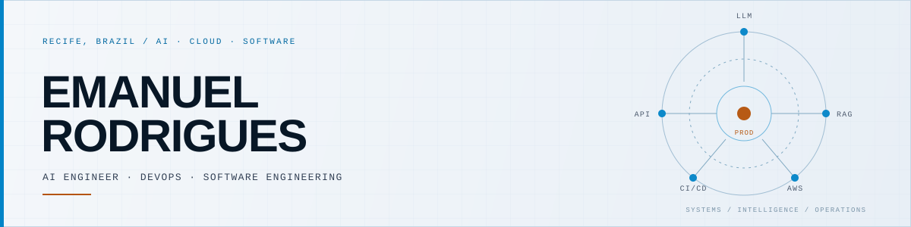
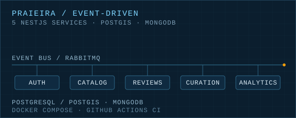
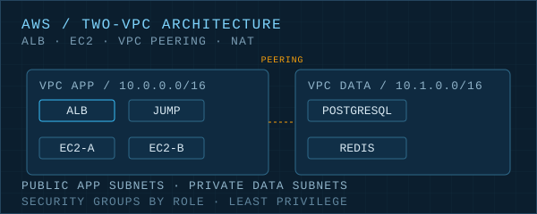
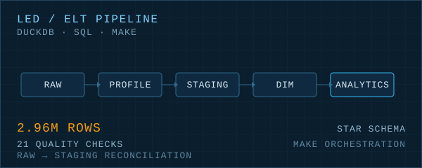

  <picture>
    <source media="(max-width: 600px)" srcset="assets/hero-mobile.svg">
    <source media="(prefers-color-scheme: dark)" srcset="assets/hero-dark.svg">
    
  </picture>

  
  
  
  

## Profile / Perfil

**Português** — Engenheiro de IA na **LeFil**, pesquisador de IA na **AIBox Lab**, cientista de dados na **LED/CIn-UFPE** e engenheiro full stack na **Livox**. Estudante de Ciência da Computação na **UFRPE** (6º período, formatura em 2028.1). Construo e opero sistemas inteligentes de ponta a ponta: LLMs/RAG, APIs em Python, dados, AWS, Docker, Terraform, Ansible e CI/CD. Minha base é engenharia de software — é o que me permite levar IA de protótipo à produção com confiabilidade.

**English** — AI Engineer at **LeFil**, AI Researcher at **AIBox Lab**, Data Science Researcher at **LED/CIn-UFPE** and Full Stack Engineer at **Livox**. Computer Science student at **UFRPE** (6th semester, expected graduation 2028). I build and operate intelligent systems end to end: LLM/RAG applications, Python APIs, data, AWS, Docker, Terraform, Ansible and CI/CD. A software engineering foundation for taking AI from prototype to production with reliability.

**Previously / Antes:** Software Developer Intern @ LeFil (2025–2026).

## Now / Agora

- **AI Engineer** — LeFil · `Aug 2026 — present`
- **AI Researcher** — AIBox Lab · `Aug 2026 — present`
- **Data Science Researcher** — LED / CIn-UFPE · `Aug 2026 — present`
- **Full Stack Engineer** — Livox · `Aug 2026 — present`
- **B.Sc. Computer Science** — UFRPE · `2024 — 2028`

## Focus / Foco

- **AI & Data / IA e Dados** — LLMs · RAG · LangChain · prompt engineering · LLMOps · Python · PyTorch · scikit-learn · pandas · NumPy · SQL · DuckDB.
- **Cloud & DevOps** — AWS · Terraform · Ansible · Docker · Docker Compose · GitHub Actions · Linux · Bash · observability · troubleshooting.
- **Software Engineering / Engenharia de Software** — TypeScript · Node.js · NestJS · PostgreSQL · MongoDB · Redis · RabbitMQ · React · Next.js · Java · Go · C/C++.

Next focus / Próximos focos: Kubernetes · observability · evaluating LLM systems in production.

## Selected systems / Sistemas selecionados

**Praieira App** · *Academic team project / Projeto acadêmico em equipe*

Plataforma de turismo orientada a eventos com 5 microsserviços NestJS, RabbitMQ, PostgreSQL/PostGIS, MongoDB, Docker Compose e CI no GitHub Actions.

Event-driven tourism platform with 5 NestJS microservices, RabbitMQ, PostgreSQL/PostGIS, MongoDB, Docker Compose and GitHub Actions CI.

[Repository / Repositório](https://github.com/emanuelrodrigues2005/praieira-app)

**AWS Two-VPC Architecture** · *Academic project / Projeto acadêmico*

Arquitetura com duas VPCs, ALB, EC2 em múltiplas AZs, VPC Peering, NAT Gateway, Security Groups e deploy containerizado.

Two-VPC architecture with ALB, EC2 across multiple AZs, VPC Peering, NAT Gateway, Security Groups and containerized deployment.

[Repository / Repositório](https://github.com/emanuelrodrigues2005/cloud-architecture-aws)

**LED ELT — NYC Taxi** · *Selection-process project · private repository / Projeto de processo seletivo · repositório privado*

Pipeline ELT com DuckDB para 2,96M de linhas, perfilamento, 21 checks de qualidade, reconciliação e orquestração com Make.

DuckDB ELT pipeline for 2.96M rows with profiling, 21 quality checks, reconciliation and Make orchestration.

**More on GitHub / Mais no GitHub:** [NestJS API](https://github.com/emanuelrodrigues2005/NestJS-API) · [CPU Renderer](https://github.com/emanuelrodrigues2005/cpu-renderer-cpp) · [Traveling Salesman](https://github.com/emanuelrodrigues2005/Caxeiro-Viajante-Python)

## Stack

**AI & Data / IA e Dados**

  

  
  
  
  
  
  
  

**Cloud & DevOps**

  

**Software Engineering / Engenharia de Software**

  

## Activity / Atividade

  
  

## Contact / Contato

**Open to DevOps, Cloud and AI Engineering roles.** 
**Aberto a oportunidades em DevOps, Cloud e Engenharia de IA.**

[LinkedIn](https://www.linkedin.com/in/emanuel-rodrigues-dev) · [GitHub](https://github.com/emanuelrodrigues2005) · [Email](mailto:emanuelrodrigues112358@gmail.com)
